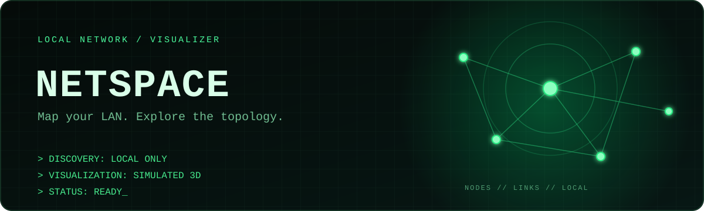

<div align="center">
  
</div>

<div align="center">
  <code>NETSPACE v1.2.0</code> &nbsp; <code>WINDOWS 10 / 11</code> &nbsp; <code>LOCAL-FIRST</code>
  <br>
  <strong>扫描你的局域网，观察设备拓扑。</strong>
</div>

---

NetSpace 是一款 Windows 本地局域网设备发现与 3D 可视化工具。它读取电脑当前连接的 Wi-Fi 或以太网网络，在本机页面上展示可解析的邻居设备、设备档案、扫描历史与推测出的同网段关系。

```text
[ READY ] adapter: Wi-Fi / Ethernet
[ LOCAL ] discovery: IPv4 neighbor resolution
[ VIEW  ] topology: simulated 3D layout
[ STORE ] history and profiles: local SQLite
```

> 仅在你拥有或获准管理的网络中使用。节点坐标是模拟布局，连线是同网段关系推断；它们不表示真实物理位置、交换机端口连接或设备拥有者。

## 演示画面

下面的画面来自内置演示模式。设备名称、IP、MAC 和拓扑均为虚构数据，不是任何真实局域网的扫描结果。


## 能做什么

```text
01  DISCOVER   查看当前接口、默认网关和可解析的邻居
02  VISUALIZE  在可旋转、可缩放的 3D 场景中查看节点
03  ANNOTATE   给设备保存别名、备注、分组和已知状态
04  REPLAY     按网络浏览历史扫描与变化记录
05  MONITOR    按 1 / 5 / 10 分钟间隔定时发现（默认关闭）
06  EXPORT     导出当前结果、历史快照或演示数据为 JSON
07  DEMO       用虚构设备体验界面，不访问真实扫描数据
```

- 记录新增、再次发现、本次未发现和 IP 变化；支持静音与按网络标记已读。
- 历史回放、演示数据和当前发现相互隔离。
- Three.js 和页面资源随项目提供，界面可以离线加载。
- SQLite 设备档案和历史数据在应用重启后保留。

## Windows 使用

当前仓库提供源码和打包脚本。**GitHub Releases 中尚无可下载的 Windows 安装包**；可以从源码运行，或自行构建独立可执行文件。

### 直接运行源码

安装 Python 3.8 或更高版本，在项目根目录执行：

```powershell
python app.py
```

不自动打开浏览器：

```powershell
python app.py --no-browser --port 8765
```

也可以双击 `start.bat`。程序会打开本机页面，默认地址为 `http://127.0.0.1:8765`；仅监听本机回环地址，不向局域网提供管理服务。

### 构建 Windows 可执行文件

```powershell
python -m pip install pyinstaller
powershell -NoProfile -ExecutionPolicy Bypass -File build.ps1
```

打包输出位于 `dist/`：

```text
dist/NetSpace.exe
dist/NetSpace-Windows-x64.zip
dist/NetSpace-Source.zip
```

程序包含 Python 运行环境和页面资源，运行时不要求另装 Python、Node.js、Docker 或抓包驱动。

## 网络发现边界

NetSpace 展示的是本机在局域网中能观察到的设备记录，不是对“同一 Wi-Fi 上所有人”的准确枚举。

- 读取 Windows 网络接口、默认网关和邻居缓存，并对选定 IPv4 网段执行原生地址解析。
- 主动探测默认按当前网段进行；大于 `/24` 的网络会把主动探测限制在本机所在 `/24`，并合并更大网段中已有的有效缓存记录。
- Wi-Fi 客户端隔离、VLAN、设备休眠和网络策略可能使设备不可见。扫描结果不能保证完整。
- 主机名或 MAC 缺失时会保留未知；设备数不等于在线人数。
- “已解析”可能来自 Windows 缓存，不保证目标当前在线；“本次未发现”也不等于确认离线。
- 不做端口扫描，不抓取通信内容，不推断真实地理位置。

## 本地数据与隐私

- 设备资料、扫描历史、变化记录和提醒设置默认保存到 `%LOCALAPPDATA%/NetSpace/netspace.db`。
- 应用默认不上传网络扫描结果；页面资源不依赖外部 CDN。
- 使用 `--data-dir` 可以指定独立数据目录：

```powershell
NetSpace.exe --data-dir D:\NetSpaceData
```

- 备份时先退出应用，再复制 `%LOCALAPPDATA%/NetSpace/`。
- 数据最多保留每个网络最近 500 次扫描和 2000 条变化记录；设备档案继续保留。

## 项目结构

```text
app.py                 本机 HTTP 服务、扫描流程与生命周期
windows_network.py     Windows 网卡、邻居缓存和原生地址解析
network_store.py       SQLite 设备档案、历史快照和变化记录
monitoring.py          定时发现与停止控制
web/                   中文界面、响应式布局和离线 3D 场景
tests/                 Python 回归测试
tools/                 打包、资源校验和 UI 验证脚本
docs/images/           README 演示图（仅虚构演示数据）
```

## 测试与打包验证

运行标准库单元测试：

```powershell
python -m unittest discover -s tests -v
```

Windows 构建后，可用打包冒烟检查验证独立运行环境、真实网络发现、跨重启持久化、定时发现和正常退出：

```powershell
python tools/packaged_smoke.py
```

**当前验证记录**：78 项 Python 测试通过；Windows 可执行文件验证通过。详细记录见 [`docs/verification-1.1-2026-11-19.md`](docs/verification-1.1-2026-11-19.md)。

## 架构速览

```text
Windows adapters / neighbor cache / native address resolution
                             │
                             ▼
                    windows_network.py
                             │
                             ▼
               app.py — local-only HTTP API
                    ┌────────┴────────┐
                    ▼                 ▼
             network_store.py    monitoring.py
              SQLite records      scheduled scans
                    └────────┬────────┘
                             ▼
                web/ — Three.js topology UI
```

## 路线图

- 可选的 Windows 系统通知。
- 更好的 MAC 随机化和设备身份合并处理。
- 可插拔发现适配器、拓扑过滤与时间轴。
- 远程只读查看（如实现，将默认关闭并加入显式访问控制）。

## 第三方组件与授权

项目内置 Three.js 0.187.0 和 OrbitControls，相关许可见 [`THIRD_PARTY_NOTICES.md`](THIRD_PARTY_NOTICES.md) 与 `web/vendor/THREE-LICENSE.txt`。Python 打包运行时的许可说明随 Windows 分发包提供。

本仓库暂未指定项目自身的开源许可证。公开可见源码不代表自动授予复制、修改或分发许可；如需复用，请先联系作者确认。

## 迭代记录

### 1.2.0 — 黑客终端界面（2026-11-20）

- 将主界面配色改为黑底荧绿，统一按钮、状态、焦点和网络节点颜色。
- 为 3D 视图区加入低对比网格扫描层，网络地址和指标使用等宽字体；保留减少动态效果与窄屏布局。
- 更新 README 演示截图，截图仅包含程序生成的虚构设备。
- **验证**：Python 单元测试、Chromium 桌面/375px 界面检查通过；没有运行时错误或外部资源请求。
- **安全审查**：本轮未发现新漏洞；完整安全强化计划在后续迭代记录中单列。
