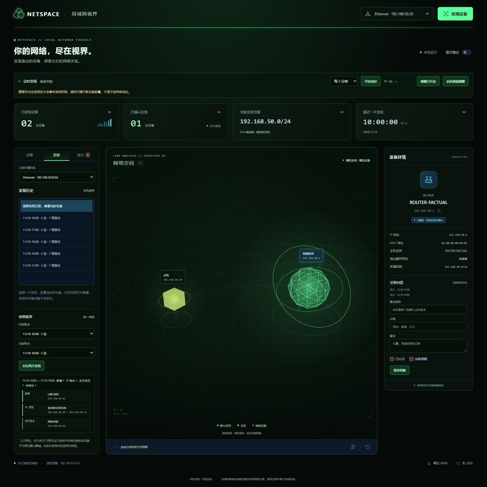
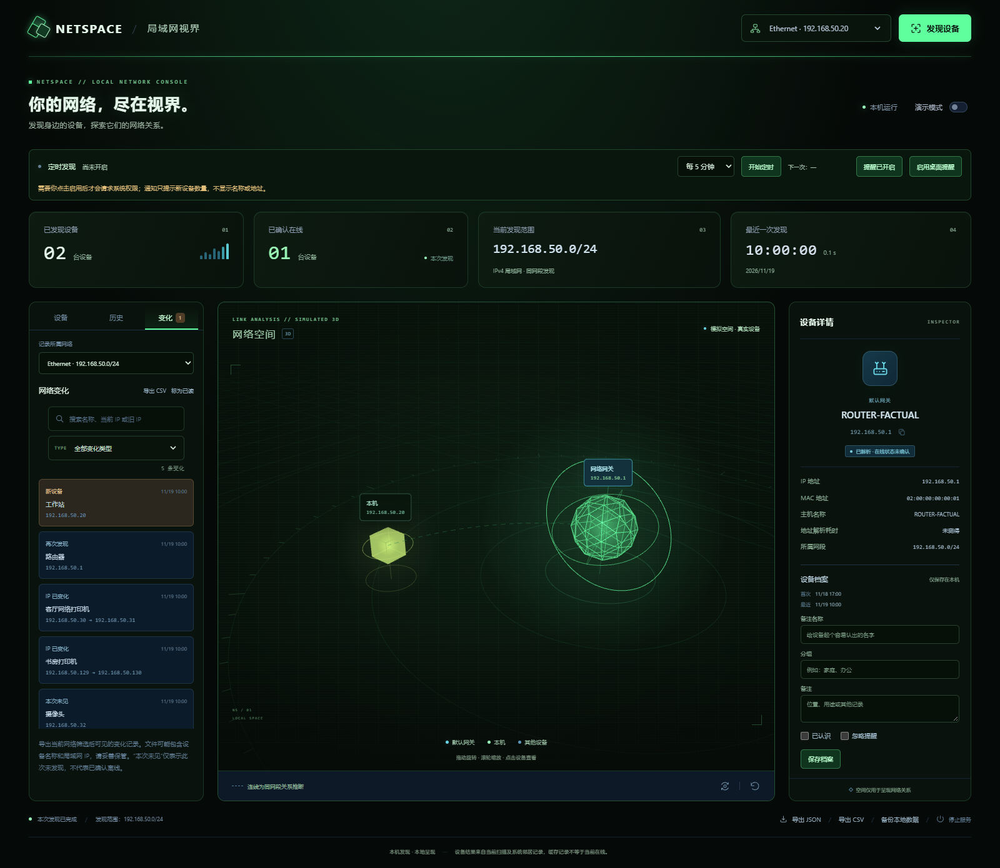
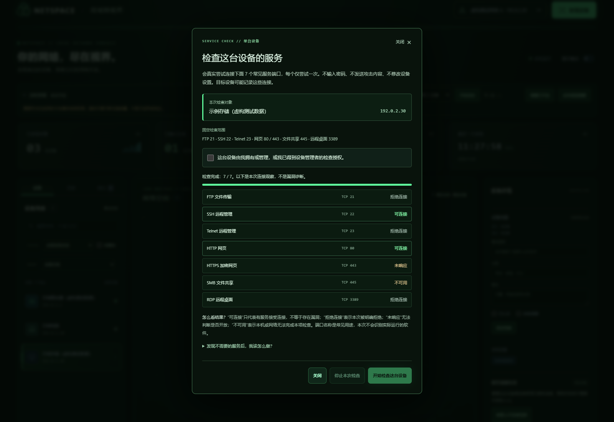
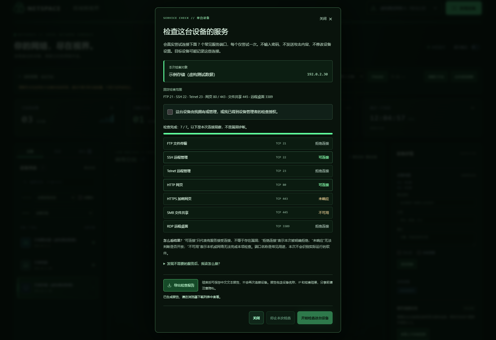

<div align="center">
  
</div>

<div align="center">
  <code>NETSPACE v1.14.0</code> &nbsp; <code>WINDOWS 10 / 11</code> &nbsp; <code>LOCAL-FIRST</code>
  <br>
  <strong>扫描你的局域网，观察设备拓扑。</strong>
</div>

---

NetSpace 是一款 Windows 本地局域网设备发现与 3D 可视化工具。它读取电脑当前连接的 Wi-Fi 或以太网网络，在本机页面上展示可解析的邻居设备、设备档案、扫描历史与推测出的同网段关系。

```text
[ READY ] adapter: Wi-Fi / Ethernet
[ LOCAL ] discovery: IPv4 neighbor resolution
[ VIEW  ] topology: simulated 3D layout
[ STORE ] history and profiles: local SQLite
```

> 仅在你拥有或获准管理的网络中使用。节点坐标是模拟布局，连线是同网段关系推断；它们不表示真实物理位置、交换机端口连接或设备拥有者。

## 演示画面

下面的画面来自内置演示模式。设备名称、IP、MAC 和拓扑均为虚构数据，不是任何真实局域网的扫描结果。


历史差异画面使用自动化测试生成的虚构设备与地址，仅演示同一网络的两次本地快照比较。



变化记录画面与 CSV 内容使用测试生成的虚构设备和地址，展示类型筛选、名称模糊搜索、IP 精确搜索与 3D 关系视图。



服务暴露检查画面使用虚构设备和连接结果替身，仅演示操作与结果含义，没有连接截图中的地址。



中文报告画面同样来自虚构测试数据。检查结果可保存为本地文本，导出操作不会重新连接设备。



## 能做什么

```text
01  DISCOVER   查看当前接口、默认网关和可解析的邻居
02  VISUALIZE  在可旋转、可缩放的 3D 场景中查看节点
03  ANNOTATE   给设备保存别名、备注、分组和已知状态
04  REPLAY     按网络浏览历史扫描与变化记录
05  MONITOR    按 1 / 5 / 10 分钟间隔定时发现（默认关闭）
06  EXPORT     导出当前结果、历史快照或演示数据为 JSON
07  DEMO       用虚构设备体验界面，不访问真实扫描数据
08  REVIEW     筛出尚未确认且未忽略的设备，并同步聚焦 3D 节点
09  GROUP      按设备档案分组筛选，并与状态、搜索和待复核条件组合
10  ALERT      可选 Windows 桌面提醒；通知只显示新设备数量
11  DIFF       比较同一网络的两次本地快照，查看设备与 IP 变化
12  CSV        导出当前筛选设备表格，方便在 Excel 中查看
13  DIFF CSV   导出两次历史快照之间的变化
14  BACKUP     下载本地 SQLite 数据库备份
15  EVENTS CSV 导出当前网络已加载的最近变化记录
16  EVENT FILTER 按类型筛选；设备名称模糊搜索，IP 精确片段搜索
17  SERVICE CHECK 手动检查一台已授权设备的 7 个常见 TCP 服务入口
18  CHECK REPORT 保存已有检查结果为中文文本，附结果含义和后续建议
```

- 记录新增、再次发现、本次未发现和 IP 变化；支持静音与按网络标记已读。
- 历史回放、演示数据和当前发现相互隔离。
- 历史快照按稳定设备记录标识比较；“本次未见”不代表设备已确认离线。
- CSV 只导出当前可见的设备，并标记当前发现、历史快照或虚构演示来源；会针对表格公式注入处理文本字段。
- 历史差异 CSV 包含新增、IP 变化和本次未见设备，并保留起始/对比地址、状态和快照时间；“本次未见”不代表已确认离线。
- 可主动下载一致性 SQLite 备份，包含设备档案、扫描历史、变化事件和设置；文件保存在浏览器下载位置，可能包含设备名称、IP 与 MAC，请妥善保管。
- 可将当前所选网络已加载的最近 50 条变化记录导出为本地 CSV；文件包含设备名称和 IP。“本次未见”只表示此次扫描没有该记录，不代表已确认离线。
- 变化记录支持按事件类型筛选；设备名称可容忍少量拼写差异，当前和旧 IP 使用连续文本片段匹配（例如搜索 `50.30`）。短片段可能同时匹配多个地址。CSV 只导出筛选后可见的记录。搜索在本机离线运行，不发送查询词或事件数据。
- Three.js 和页面资源随项目提供，界面可以离线加载。
- SQLite 设备档案和历史数据在应用重启后保留。
- 可选桌面提醒需在界面中手动授权；无权限或不支持时继续使用页面内提醒。桌面提醒只在 NetSpace 页面打开期间运行，且不显示设备名称、IP 或 MAC。
- 服务暴露检查必须手动选择设备并在每次开始前勾选授权；只对该设备的固定 7 个 TCP 端口尝试连接。结果只留在本次应用进程内，不写入设备档案、历史或数据库备份。
- 已结束且有结果的检查可一键导出中文文本报告，取消或出错后的部分结果也可保留，其余端口明确标为“未检查”。报告在本机生成，不增加设备连接；保存的文件包含设备名称、IP 和结果。

## Windows 使用

当前仓库提供源码和打包脚本。**GitHub Releases 中尚无可下载的 Windows 安装包**；可以从源码运行，或自行构建独立可执行文件。

### 直接运行源码

安装 Python 3.8 或更高版本，在项目根目录执行：

```powershell
python app.py
```

不自动打开浏览器：

```powershell
python app.py --no-browser --port 8765
```

也可以双击 `start.bat`。程序会打开本机页面，默认地址为 `http://127.0.0.1:8765`；仅监听本机回环地址，不向局域网提供管理服务。

### 构建 Windows 可执行文件

```powershell
python -m pip install pyinstaller
powershell -NoProfile -ExecutionPolicy Bypass -File build.ps1
```

打包输出位于 `dist/`：

```text
dist/NetSpace.exe
dist/NetSpace-Windows-x64.zip
dist/NetSpace-Source.zip
```

程序包含 Python 运行环境和页面资源，运行时不要求另装 Python、Node.js、Docker 或抓包驱动。

### 检查一台设备的常见服务

1. 在你拥有或获准管理的网络中打开 NetSpace，选择当前 Wi-Fi 或以太网适配器，点击发现设备。
2. 在设备列表或 3D 图中选中一台其他设备，在详情中的“服务暴露检查”点击“了解并检查”。
3. 阅读检查对象与固定范围，确认已获得该设备的检查授权后勾选，再点击“开始检查这台设备”。每次开始都需要重新勾选。
4. 查看每个端口的观察结果；需要时点击“停止本次检查”。关闭检查窗口只收起窗口，正在进行的检查会继续。
5. 检查结束后点击“导出检查报告”，在浏览器下载列表中打开中文 .txt 文件。报告列出已检查和未检查端口、各结果的含义及后续建议；取消后只要已有结果，也能导出。

| 结果 | 表示什么 |
| --- | --- |
| 可连接 | 该 TCP 端口接受了连接；不代表存在漏洞，也不确认运行的具体软件 |
| 拒绝连接 | 本次连接尝试被拒绝 |
| 未响应 | 在本次等待时间内没有得到结果，无法据此判断端口是否开放 |
| 不可用 | 连接过程发生其他网络或系统错误，本次无法完成判断 |

固定范围是 **TCP 21、22、23、80、443、445、3389**，分别标注 FTP、SSH、Telnet、HTTP、HTTPS、SMB 和远程桌面的常见用途。检查仅尝试建立连接并立即关闭，不输入密码、不发送应用数据、不执行漏洞利用、不修改设备设置；目标设备可能记录这些连接。端口名称只是常见用途，不是服务识别结果。

仅可检查本次应用进程中**最近 5 分钟内最新发现**的其他设备；当前网卡的 IP、前缀、网关和 MAC 必须与发现时一致，目标必须位于当前网卡的同一子网及本次发现范围内，且属于 `10.0.0.0/8`、`172.16.0.0/12` 或 `192.168.0.0/16` 私网。历史快照、演示数据、过期记录、公网地址和本机地址不能用于检查。网络变化或记录过期时，先重新发现设备；同一时刻只允许一项检查。结果按网络、设备和本次扫描记录关联，重新发现后不会沿用上次的检查结果。网卡参数和 IP 记录不能认证设备的真实身份。

发现不需要的入口后，先确认设备用途，再通过设备自己的管理页面或设置关闭不使用的服务，并安装官方更新。开放端口不等于漏洞或被入侵，NetSpace 不会自动替你修改设备。

每次开始会核对你在窗口中看到的扫描记录；记录被其他窗口更新时，旧授权不能用于新地址。停止操作绑定独立的检查任务，旧窗口的停止请求不会影响后来启动的另一项任务。

报告是已有结果的副本，过期但仍对应本次记录的结果可查看与导出；开始新检查仍须重新发现设备。程序尚未记录准确检查时间，因此报告分别注明“发现时间”和“报告生成时间”，二者都不是检查时间。文件使用 UTF-8 BOM 和 Windows 换行，设备名称等文本会清理换行及方向控制字符。

## 网络发现边界

NetSpace 展示的是本机在局域网中能观察到的设备记录，不是对“同一 Wi-Fi 上所有人”的准确枚举。

- 读取 Windows 网络接口、默认网关和邻居缓存，并对选定 IPv4 网段执行原生地址解析。
- 主动探测默认按当前网段进行；大于 `/24` 的网络会把主动探测限制在本机所在 `/24`，并合并更大网段中已有的有效缓存记录。
- Wi-Fi 客户端隔离、VLAN、设备休眠和网络策略可能使设备不可见。扫描结果不能保证完整。
- 主机名或 MAC 缺失时会保留未知；设备数不等于在线人数。
- “已解析”可能来自 Windows 缓存，不保证目标当前在线；“本次未发现”也不等于确认离线。
- 默认设备发现不扫描端口；只有手动授权的单设备服务暴露检查会连接上述固定 7 个 TCP 端口。不抓取通信内容，不推断真实地理位置。

## 本地数据与隐私

- 设备资料、扫描历史、变化记录和提醒设置默认保存到 `%LOCALAPPDATA%/NetSpace/netspace.db`。
- 应用默认不上传网络扫描结果；页面资源不依赖外部 CDN。
- 使用 `--data-dir` 可以指定独立数据目录：

```powershell
NetSpace.exe --data-dir D:\NetSpaceData
```

- 备份时先退出应用，再复制 `%LOCALAPPDATA%/NetSpace/`。
- 数据最多保留每个网络最近 500 次扫描和 2000 条变化记录；设备档案继续保留。
- 服务暴露检查的进度与结果仅保存在内存，退出应用后清除；它们不写入 SQLite，也不包含在数据库备份内。
- 主动导出的 .txt 检查报告会留在浏览器下载位置，退出程序不会删除。文件含设备名称、IP 和检查结果，分享前请按需遮盖。

## 项目结构

```text
app.py                 本机 HTTP 服务、扫描流程与生命周期
windows_network.py     Windows 网卡、邻居缓存和原生地址解析
network_store.py       SQLite 设备档案、历史快照和变化记录
monitoring.py          定时发现与停止控制
device_check.py        单设备固定 TCP 端口连接检查
web/                   中文界面、响应式布局和离线 3D 场景
tests/                 Python 回归测试
tools/                 打包、资源校验和 UI 验证脚本
docs/images/           README 演示图（仅虚构演示数据）
```

## 测试与打包验证

运行标准库单元测试：

```powershell
python -m unittest discover -s tests -v
```

Windows 构建后，下面的检查只验证程序启动、离线资源、初始空闲状态与退出，不枚举网卡、不发现设备、不连接设备端口：

```powershell
python tools/packaged_smoke.py --no-network
```

省略该选项会执行真实网络发现，用于验证跨重启持久化和定时发现；仅在你拥有或获准管理的网络中运行：

```powershell
python tools/packaged_smoke.py
```

**1.14.0 验证结果**：108 项 Python 测试、11 项纯报告测试、3 项内存任务竞态测试、单设备检查与现有浏览器回归、320/375 px 布局、Windows 构建及 `--no-network` 打包检查通过。本轮使用虚构网卡、发现记录和连接替身，未执行真实设备发现、连接或攻击；未运行原生发现验收路径。完整结果与修复前的失败复现见 [docs/verification-1.14.0-2026-11-20.md](docs/verification-1.14.0-2026-11-20.md)。先前版本的验证不代表本轮真实网络实测。

## 架构速览

```text
Windows adapters / neighbor cache / native address resolution
                             │
                             ▼
                    windows_network.py
                             │
                             ▼
               app.py — local-only HTTP API
                    ┌────────┴────────┐
                    ▼                 ▼
             network_store.py    monitoring.py
              SQLite records      scheduled scans
                    └────────┬────────┘
                             ▼
                web/ — Three.js topology UI
```

## 路线图

- 更好的 MAC 随机化和设备身份合并处理。
- 可插拔发现适配器、拓扑过滤与时间轴。
- 远程只读查看（如实现，将默认关闭并加入显式访问控制）。

## 第三方组件与授权

项目内置 Three.js 0.187.0、OrbitControls 和 Fuse.js 7.5.0；依赖固定并随程序本地提供，不使用 CDN。许可见 THIRD_PARTY_NOTICES.md、web/vendor/THREE-LICENSE.txt 和 web/vendor/FUSE-LICENSE.txt。Python 打包运行时的许可说明随 Windows 分发包提供。

### 本轮 GitHub 调研与择用

- **已复用**：[Three.js](https://github.com/mrdoob/three.js) 的本地 3D 渲染与 OrbitControls（MIT）；[Fuse.js v7.5.0](https://github.com/krisk/Fuse/tree/v7.5.0) 的离线名称模糊搜索（Apache-2.0，提交 `45bac9fe2e71fe8c680c861a35a8b226c4ae6d5a`）。相关上游代码和许可证已随仓库提供。
- **本轮实现选择**：使用 [CPython 标准库 socket](https://docs.python.org/3.8/library/socket.html#socket.create_connection) 完成有限的 TCP connect 检查，无新增第三方扫描器、命令行工具或驱动依赖。CPython 的 PSF 及相关运行时许可随打包程序提供；这里使用标准库 API，没有复制其他扫描器源码。
- **参考，未集成 Nmap**：[Nmap 官方 TCP connect 说明](https://nmap.org/book/scan-methods-connect-scan.html) 用于核对连接方式和日志影响。核查的[官方仓库提交](https://github.com/nmap/nmap/tree/bb81d1392145080d93ff50d91e1598bdde5248e3) 使用 [NPSL 0.95](https://github.com/nmap/nmap/blob/bb81d1392145080d93ff50d91e1598bdde5248e3/LICENSE)；[官方法律说明](https://nmap.org/book/man-legal.html) 还列出 Npcap 独立分发限制。本轮只需固定 7 个端口的连接观察，因此不捆绑 Nmap 或 Npcap。
- **后续参考，未接入网页检查**：[OWASP Secure Headers Project](https://github.com/OWASP/secure-headers-project/tree/0e7ad7d75ee45e02b55d1b426c4c5e43ef8b7de0) 提供 HTTP 安全头资料，采用 Apache-2.0。它适合后续评估网页配置提示；本轮服务检查只观察 TCP 连接，不读取 HTTP 内容，也不将缺少响应头认定为漏洞。

本仓库暂未指定项目自身的开源许可证。公开可见源码不代表自动授予复制、修改或分发许可；如需复用，请先联系作者确认。

## 迭代记录

### 1.2.0 — 黑客终端界面（2026-11-20）

- 将主界面配色改为黑底荧绿，统一按钮、状态、焦点和网络节点颜色。
- 为 3D 视图区加入低对比网格扫描层，网络地址和指标使用等宽字体；保留减少动态效果与窄屏布局。
- 更新 README 演示截图，截图仅包含程序生成的虚构设备。
- **验证**：Python 单元测试、Chromium 桌面/375px 界面检查通过；没有运行时错误或外部资源请求。
- **安全审查**：本轮未发现新漏洞；完整安全强化计划在后续迭代记录中单列。

### 1.3.0 — 设备发现状态筛选（2026-11-20）

- 可分别查看已确认在线、已解析但在线状态未确认、系统缓存和待确认设备。
- 状态筛选与名称/IP/MAC 搜索联动；设备列表、3D 节点和匹配数量同步更新。切换网卡、演示或历史视图时筛选自动清空。
- 原有发现依据及在线状态说明不变；没有证据时不会把地址解析结果称为在线。
- **验证**：新增 Playwright 检查覆盖四种状态、筛选与搜索组合、筛选数量和重置；Python 78 项回归及 Chromium 桌面/移动检查通过。
- **安全审查**：只读代码审查没有确认新漏洞；无新网络请求或外部资源。

### 1.3.1 — 浏览器内容安全策略（2026-11-20）

- 为页面、静态资源、接口和错误响应统一添加内容安全策略：仅允许同源脚本与网络请求，允许当前静态导入映射的精确 SHA-256 哈希，禁止对象嵌入与页面被框架加载。
- 为现有 3D 标签定位保留行内样式权限；脚本仍不允许任意行内代码。此策略是纵深防御，不能替代输入安全处理，也无法防止本机上已获准访问用户数据的恶意程序。
- **验证**：79 项 Python 回归通过，覆盖 HTML、接口、静态资源及 404 响应头；Chromium 检查确认 CSP 无违规、Three.js 场景正常且无外部请求；Windows 单文件打包及原生发现、数据库重启持久化、定时发现和退出流程均通过。详见 [`docs/verification-1.3.1-2026-11-20.md`](docs/verification-1.3.1-2026-11-20.md)。
- **安全审查**：只读代码审查未发现当前页面与策略之间的明显冲突；仍需以浏览器及打包测试确认运行时行为，不将结果表述为“无漏洞”。

### 1.4.0 — 待复核设备队列（2026-11-20）

- 新增“待复核”快捷筛选：显示尚未标记为“已认识”、也未选择“忽略提醒”的网络设备，自动排除本机。
- 筛选与发现状态、名称/IP/MAC 搜索联动；设备数、可见节点和 3D 拓扑同步更新。保存设备档案为“已认识”或“忽略提醒”后，该设备退出复核队列。
- 切换网卡、演示数据或历史快照时清除筛选；演示中预先安排了已认识、已忽略和待复核样例，方便查看功能。
- **验证**：79 项 Python 测试通过；Chromium 主流程、网络恢复与档案/历史升级检查通过，覆盖筛选组合、设备标记已认识后退出队列、重置行为、3D 联动、无 CSP 违规及移动布局；Windows 单文件重建、原生发现和重启后数据持久化验证通过。详见 [`docs/verification-1.4.0-2026-11-20.md`](docs/verification-1.4.0-2026-11-20.md)。

### 1.5.0 — Windows 桌面提醒与扫描恢复（2026-11-20）

- 新增可选桌面通知，必须由用户点击启用后才申请系统权限；页面打开且获得授权时，新设备事件可显示 Windows 桌面提醒。
- 通知内容仅包含新设备数量，不包含名称、IP 或 MAC；不支持或拒绝权限时继续使用页面内提醒，现有静音设置保持生效。演示数据、历史回放和忽略的设备不会触发新设备通知。
- 扫描线程启动失败时明确进入错误状态，修复后允许再次发现；扫描记录验证拒绝 NaN 与无穷大耗时，避免异常数据造成存储事务失败。
- **验证**：Python 81 项测试通过；Chromium 覆盖未自动请求权限、点击授权、拒绝权限降级、隐私内容和重复提醒抑制；桌面及 375 px 窄屏布局、无 CSP 违规和无外部请求检查通过。Windows 单文件构建与打包运行检查通过。详见 [`docs/verification-1.5.0-2026-11-20.md`](docs/verification-1.5.0-2026-11-20.md)。

### 1.6.0 — 设备档案分组筛选（2026-11-20）

- 设备列表新增“分组”筛选，自动读取当前结果中已有的本地设备档案分组，并提供“未分组”选项。
- 分组筛选与发现状态、待复核和名称/IP/MAC 搜索组合；设备列表、匹配数量和 3D 节点同步更新。切换网卡、演示或历史视图时自动清空。
- 保存、改名或清空设备档案分组后，筛选选项立即更新；不新增网络访问、数据库表或第三方依赖。
- **验证**：Python 81 项测试通过；Chromium 覆盖真实结果与演示数据中的分组、未分组、组合筛选、档案变更、网卡切换重置、3D 联动和 375 px 布局；Windows 单文件构建与打包运行检查继续通过。详见 [docs/verification-1.6.0-2026-11-20.md](docs/verification-1.6.0-2026-11-20.md)。

### 1.7.0 — 历史快照差异（2026-11-20）

- 历史页可选择同一网络的两次本地发现快照，按稳定设备标识展示新增、IP 变化、本次未见和未变化记录，并给出设备数及变化数量摘要。
- 切换网络、快照选择或进入演示模式时会清除结果并使尚未完成的读取失效；请求返回时再次验证网络和快照身份，防止过期或错网结果混入。
- 如果历史保留策略移除了当前选中的快照，比较结果会同步清除，避免显示已不再对应选择器的旧摘要。
- 设备名称与地址始终以纯文本展示；“本次未见”仅表示快照里没有发现记录，不能据此确认设备离线。该功能只读取本机保存的历史记录。
- **验证**：Python 回归、Chromium 差异分类/保留清理/恶意名称检查、手动和自动网络切换、演示模式竞态、375 px 布局及 Windows 打包检查通过。详见 [docs/verification-1.7.0-2026-11-20.md](docs/verification-1.7.0-2026-11-20.md)。

### 1.8.0 — 筛选设备 CSV 导出（2026-11-20）

- 可把设备搜索、发现状态、待复核和分组组合后的当前可见设备导出为 CSV；没有匹配设备时导出按钮会禁用。
- 表格包含发现来源、导出和扫描时间、网络范围、设备身份、状态、档案与发现依据；当前发现、历史快照和虚构演示数据使用不同来源标签。
- 文件使用 UTF-8 BOM 与标准 CSV 引号转义，兼容 Windows 表格软件；文本单元格若在前导空白、格式控制符或 NUL 后出现公式触发字符（含全角形式），会加前缀作为文本处理。导出完全在本机完成，不增加网络请求或依赖。
- **验证**：浏览器检查覆盖当前筛选集合、空结果禁用、历史/演示/当前数据来源、中文 BOM、带逗号和引号的字段，以及 ASCII、全角、前置空白和 NUL 公式注入载荷。Python 81 项测试、Windows 单文件构建与打包运行检查通过。详见 [docs/verification-1.8.0-2026-11-20.md](docs/verification-1.8.0-2026-11-20.md)。

### 1.9.0 — 历史差异 CSV 导出（2026-11-20）

- 在“历史 → 快照差异”中新增导出按钮；只有同一网络的比较结果存在实际变化时才可用，切换网络、清理快照、进入演示或选择相同快照后会禁用。
- 文件逐项列出新增、IP 变化和本次未见设备，包含来源、网络范围、起始/对比扫描时间、设备身份、MAC、对应 IP、前后状态、分组、备注和说明。
- 复用 UTF-8 BOM、CSV 引号转义和公式注入保护；备注里的逗号、引号及换行保留为单元格内容。“本次未见”行明确标注不等于确认离线。
- **验证**：Chromium 将导出文件逐字段解析，检查变化类别、旧/新地址、中文编码、来源、公式型别名/分组、带换行的备注、空差异禁用、过期网络隔离以及 320/375 px 布局。完整验证记录见 [docs/verification-1.9.0-2026-11-20.md](docs/verification-1.9.0-2026-11-20.md)。

### 1.10.0 — 本地数据备份（2026-11-20）

- 页面底部新增“备份本地数据”操作，点击后下载 SQLite 数据库副本；包含设备档案、网络历史、变化事件与通知设置。
- 使用 SQLite 在线备份接口创建一致性快照，可在发现或档案写入期间安全生成；通过本机来源校验与完整性检查，响应不暴露数据库实际路径。
- 备份文件名由服务端生成固定格式，接口不接收路径或文件名参数；不提供覆盖式恢复操作。备份可能含设备名称、IP、MAC 和自定义备注，保存后请妥善保管。
- **验证**：Python 测试验证完整性、档案/历史/事件/设置恢复可读、跨来源拒绝及友好错误；Chromium 验证实际下载、失败重试、服务停止状态及移动布局；Windows 打包冒烟检查通过。详见 [docs/verification-1.10.0-2026-11-20.md](docs/verification-1.10.0-2026-11-20.md)。

### 1.11.0 — 网络变化记录 CSV（2026-11-20）

- 变化页新增 CSV 导出，包含当前选中网络已加载的最多 50 条事件、设备名称、发生时间、前后 IP、网络范围和导出来源。
- 复用 UTF-8 BOM、CSV 引号与换行处理及表格公式注入防护；下载文件仅在本机生成。
- 当前网络没有记录、已停止服务、历史回看或演示模式下，导出按钮不可用；导出前按当前网络筛选，避免混入其他网络的设备记录。
- “本次未见”行清楚提示这不代表已确认离线；界面提示文件可能含设备名称和局域网 IP。
- **验证**：浏览器检查覆盖事件分类、字段解析、中文编码、公式型名称、含逗号/引号/换行文本、跨网络隔离、50 条边界、历史/演示隔离、空记录禁用和 320 px 布局；Windows 打包程序、CSP 和现有回归检查通过。详见 [docs/verification-1.11.0-2026-11-20.md](docs/verification-1.11.0-2026-11-20.md)。

### 1.12.0 — 网络变化筛选与模糊搜索（2026-11-20）

- 变化记录页新增类型筛选和设备名称、当前 IP、旧 IP 搜索；Fuse.js 用于设备名称模糊匹配，IP 使用精确片段匹配，结果保持事件时间顺序。
- 列表与 CSV 导出共用相同的筛选结果；空匹配时禁用导出并显示提示。筛选只作用于当前选中的网络，网络切换时自动清空；未读数量仍统计该网络全部未读事件。
- 从 GitHub 固定引入 Fuse.js 7.5.0（Apache-2.0，commit 45bac9fe2e71fe8c680c861a35a8b226c4ae6d5a），本地离线加载并保留上游许可证。
- **验证**：浏览器回归覆盖容错名称搜索、类型与搜索组合、未读数保持、筛选后 CSV 字段、空结果禁用、网络切换清空、恶意名称纯文本和 320 px 布局；Python 测试、Windows 打包、许可文件随包、CSP 与无外部请求检查通过。详见 [docs/verification-1.12.0-2026-11-20.md](docs/verification-1.12.0-2026-11-20.md)。

### 1.13.0 — 单设备服务暴露检查（2026-11-20）

- 在设备详情中新增手动检查入口，逐次确认授权后，对选中设备的 TCP 21、22、23、80、443、445、3389 各尝试一次连接；提供进度和停止操作，结果分为可连接、拒绝连接、未响应和不可用。
- 目标由服务端从本次进程最新、5 分钟内的发现记录解析；核对当前网卡参数、同子网、发现范围和 RFC 1918 私网，拒绝演示、历史、过期、公网和本机目标。浏览器不能自填目标 IP 或端口。
- 检查不登录、不发送应用数据、不执行漏洞利用，也不修改设备设置；开放入口不等于漏洞。结果仅驻留内存，不写入历史、档案或数据库备份。
- 继续复用 Three.js 与 Fuse.js；服务检查使用 Python 标准库，参考官方 Nmap TCP connect 原理，未引入 Nmap、Npcap 或其他扫描器依赖。
- 更新新手步骤、结果含义、GitHub 择用说明和虚构截图；新增不访问局域网的打包检查模式。本轮 101 项 Python 测试、浏览器回归和 Windows 构建及无网络发现的打包检查通过，未执行真实设备扫描或连接；完整结果见 [docs/verification-1.13.0-2026-11-20.md](docs/verification-1.13.0-2026-11-20.md)。

### 1.14.0 — 中文检查报告与多窗口任务保护（2026-11-20）

- 新增“导出检查报告”：把已结束检查的结果保存为中文文本，列出七个固定端口、通俗解释和后续建议。取消或出错时保留已有结果，剩余端口标为“未检查”；导出不会再次访问设备。
- 报告采用 Windows 兼容的 UTF-8 BOM 与换行，清理名称中的换行和方向控制字符，固定下载文件名；注明设备名称与 IP 的分享隐私。发现时间、报告生成时间都明确说明不是检查时间。
- 开始检查时核对用户所见的扫描记录，避免另一窗口更新同设备的 IP 后仍沿用旧授权；每次检查使用独立任务标识，旧窗口的停止操作不能取消后来的任务。
- 修复旧进度与旧取消响应覆盖新任务的竞态，以及窗口销毁后旧响应继续渲染的问题；取消前的进度读取也不能覆盖取消结果。
- 保留真实的有限 TCP 连接实现，继续复用现有 Three.js、Fuse.js 和标准库；本轮未增加漏洞利用引擎或第三方依赖。
- **验证**：108 项 Python 测试、11 项纯报告测试、3 项纯内存竞态测试、现有与新服务检查浏览器回归、Windows 构建和不进行设备发现的打包检查通过。更新虚构截图、新手导出步骤与本轮记录；没有对真实设备扫描、连接或发起攻击。详见 [docs/verification-1.14.0-2026-11-20.md](docs/verification-1.14.0-2026-11-20.md)。
