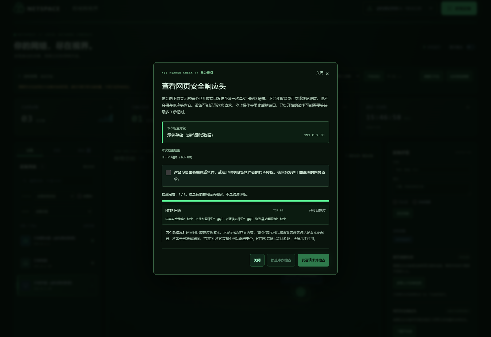
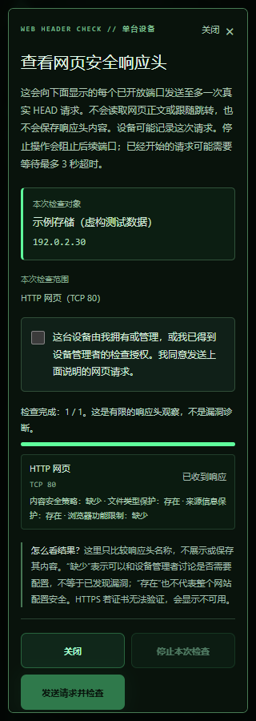

# NetSpace 1.15.0 验证记录

日期：2026-11-20

## 本轮内容

1.15.0 增加可选的网页安全响应头检查。用户必须逐次授权，并先完成同一设备、同一最新发现记录的服务检查；程序只对其中已确认开放的 TCP 80/443 端口逐个最多发送一次 `HEAD /`。检查不读取网页正文、不跟随跳转、不显示或保存响应头值，结果仅保存在当前进程内存。它提供固定响应头名称的配置提示，不构成漏洞结论或完整网站安全审计。

未增加第三方依赖；复用项目中已有的 Three.js、Fuse.js 和 Python 标准库。

## 验证结果

- `python -m unittest discover -s tests -v`：124 项通过，耗时 29.672 秒。新增覆盖包括逐次授权、目标与端口必须来自服务器验证的最新发现及服务检查、响应内容脱敏、HTTPS 证书验证、重定向不跟随、取消、关闭应用和旧任务隔离。
- `node tools/test_device_check_report.cjs`：11 项纯内存报告检查通过；`node tools/test_device_check_tasks.cjs`：3 项异步任务顺序检查通过。两者不执行网络操作。
- Chromium 浏览器回归 `ui_device_check.cjs`、`ui_smoke.cjs`、`ui_recovery.cjs`、`ui_upgrade.cjs` 全部通过。新功能检查使用虚构设备、替代 API 与网页连接器；覆盖授权、端口范围、结果展示、任务取消、重复与延迟响应隔离、响应式布局，以及既有扫描、历史、CSV、备份、通知和 3D 页面。`ui_upgrade.cjs` 使用只监听本机回环地址的静态应用服务，其 API 全部由测试替身响应。
- Windows 单文件构建：`./build.ps1 -OutputDirectory artifacts/release-1.15.0` 成功。生成 `NetSpace.exe`、`NetSpace-Windows-x64.zip` 和 `NetSpace-Source.zip`。
- 打包冒烟：`python tools/packaged_smoke.py --exe artifacts/release-1.15.0/NetSpace.exe --no-network --port 18766` 通过。它验证无 Python 环境启动、内置页面与 3D 资源、单实例行为、初始空闲状态和正常退出；此模式不枚举网卡、不发现设备，也不连接设备端口。
- `git diff --check` 通过。回归脚本重写的三张既有截图与版本库画面逐像素一致，已恢复；本轮新增截图保留在下方。

## 安全范围与限制

本轮开发和验证没有对真实局域网执行设备发现、端口连接或攻击。浏览器与界面回归使用虚构网卡、虚构发现记录和替代服务。打包冒烟仅通过 `127.0.0.1` 检查应用本身。

这项功能只有在用户手动打开并授权后才会运行。它依赖先前那次服务检查的开放端口观察；观察会绑定网络、设备和发现记录。HTTP/HTTPS 服务器、反向代理和应用路由可能不支持 `HEAD`；不受信任或与目标 IP 不匹配的 HTTPS 证书会导致该端口不可用。响应头存在不代表站点整体安全，响应头缺少也不等于确认漏洞。停止操作可阻止后续端口，但已经开始的请求可能等待最多 3 秒超时。

## 截图

以下截图来自 Chromium 测试夹具，设备、地址、开放端口和响应均为虚构，并非真实设备检查结果。

